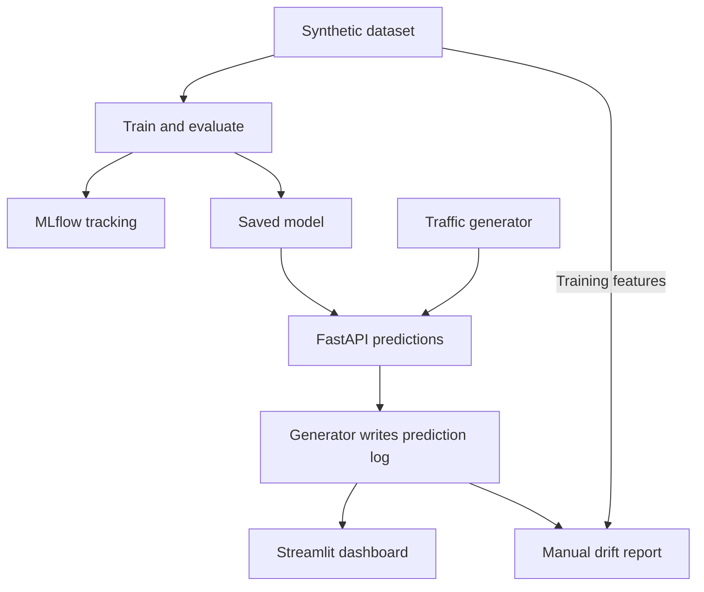

# ML Sentinel

ML Sentinel trains a Random Forest classifier on synthetic data and serves predictions through a FastAPI API. A traffic generator sends sample requests and logs the results. A Streamlit dashboard summarizes these predictions, while a separate Evidently script compares incoming feature distributions with training data to report data drift.

## How It Works

1. **Prepare data:** Generate 100,000 samples with 12 features and stratified train/validation/test splits of 70%/15%/15%.
2. **Train and track:** Evaluate the classifier on validation data, save it locally, and log metrics, artifacts, and the model to MLflow.
3. **Serve and log:** Return a predicted class and class-1 probability through `POST /predict`. The traffic generator sends random requests every two seconds and logs successful responses.
4. **Monitor:** View prediction summaries in Streamlit and manually generate an HTML data drift report.

## Tech Stack

Python, scikit-learn, pandas, MLflow, FastAPI, Streamlit, Plotly, and Evidently.

## Current Scope

This is a synthetic-data demonstration, not a validated financial risk model. The dashboard reads logs when executed or rerun; drift reporting is manual. Automated retraining and chaos testing are not implemented.

## Project Objective

Demonstrate an ML workflow covering model training, experiment tracking, API inference, prediction logging, and input data drift monitoring.

## Learning Outcomes

- Generate synthetic data and create stratified dataset splits.
- Evaluate a classifier using accuracy, precision, recall, F1, and ROC AUC.
- Track experiments and register models with MLflow.
- Serve predictions through FastAPI and log simulated traffic.
- Visualize prediction patterns and identify input distribution changes.
